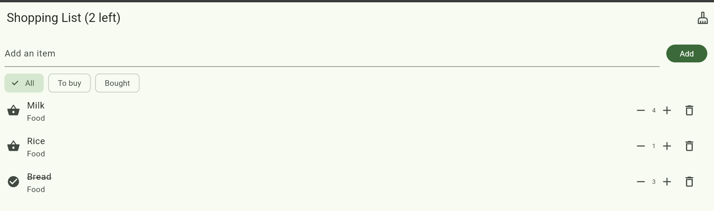
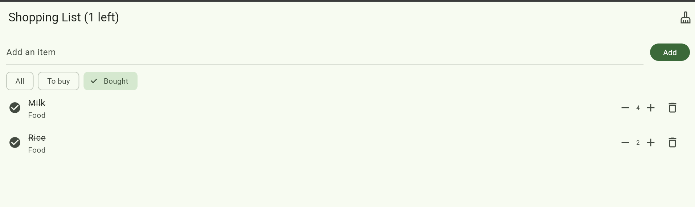
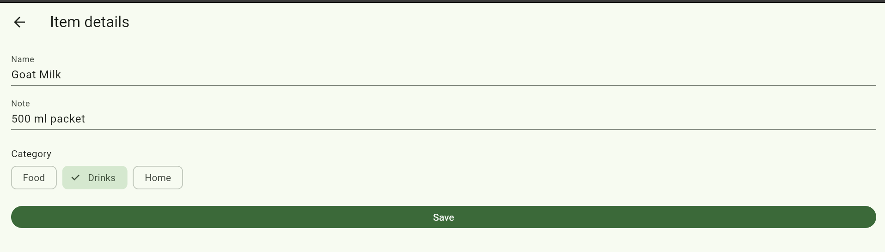

# Shopping List+

A Flutter shopping list app.

## Features
1. Empty-list message
2. Quantities with − and + buttons (never below 1)
3. Adding an existing item (any capitals or spaces) raises its quantity
4. Undo after delete, restoring the item in the same place
5. All / To buy / Bought filters, bought items at the bottom of All
6. Item details screen: name, note and category (long-press an item)

## Screenshots

## Think
## Think

1. When a filter is on, the list on the screen is a shorter list made from items, so row 0 on the screen is not always item 0 in my real list. If I delete by index, I delete the wrong item and there is no error. I fixed it by deleting the item itself with items.remove(item), not by its position.

2. The details screen has to change the name when the user renames an item, and a final field can only be set once. So I removed final from name. final is still a good choice for most fields because it protects a value from being changed by accident, so there are fewer bugs and the code is easier to read.

3. Hot reload keeps the data the app already has in memory. The old items were made before quantity existed, so they did not have it. A hot restart starts the app again and builds the items from the new Item class. Whenever I change what an object stores, I need a hot restart.

4. Flutter does not watch my data. It only draws the screen again when I tell it something changed, with setState. The details screen changed the item, but the list screen was not told, so it kept showing the old name. The setState inside .then runs when the user comes back, so build runs again and shows the new data.